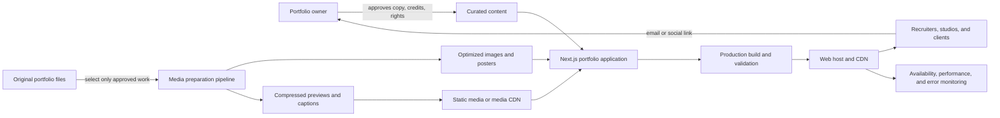
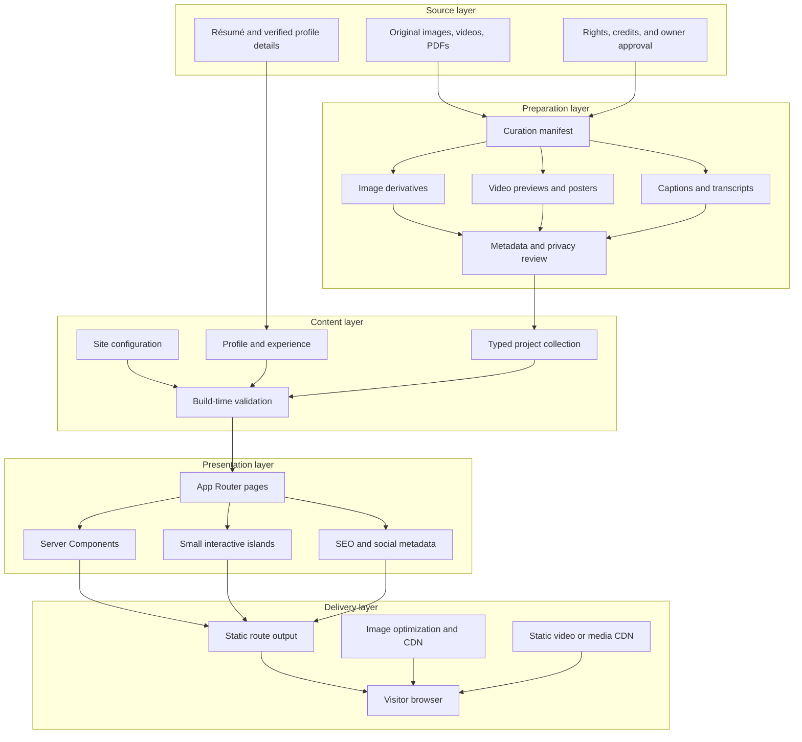
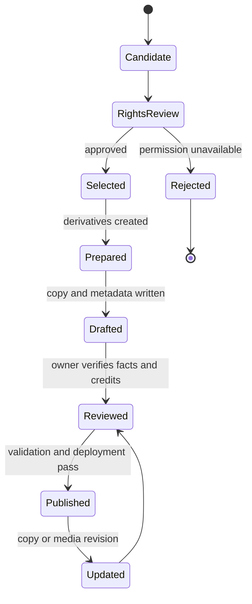
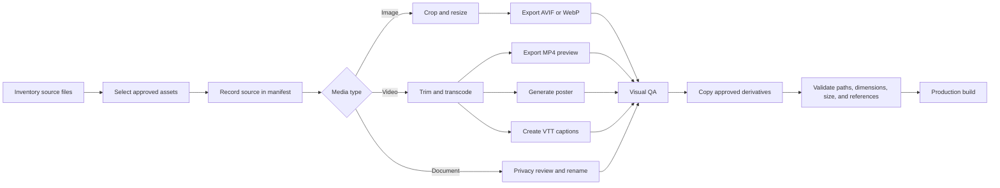
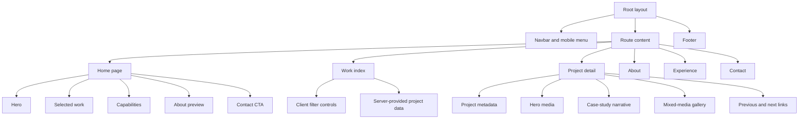
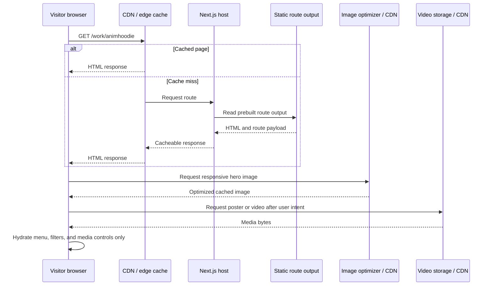
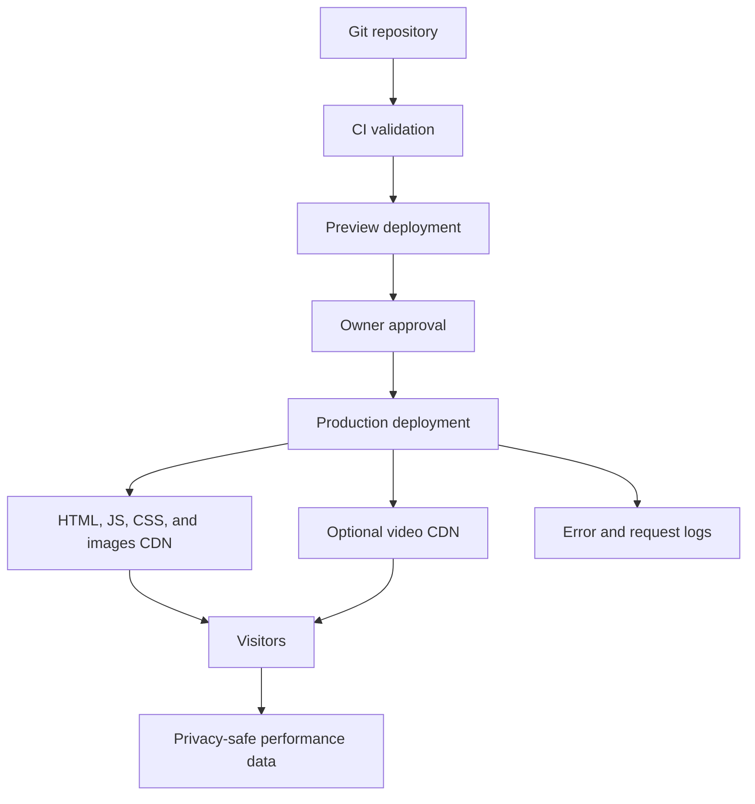
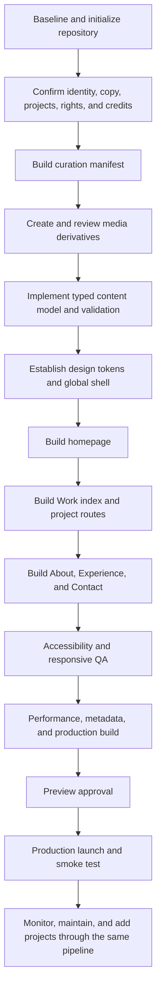

# Portfolio Website Architecture and Full Delivery Pipeline

Status: implementation architecture  
Companion plan: [`BUILD_PLAN.md`](./BUILD_PLAN.md)  
Application root: `Port-full/Web`  
Source-media root: `Port-full/Portfolio`  
Stack: Next.js 16 App Router, React 19, TypeScript, Tailwind CSS 4

## 1. Architecture goals

The system should make the portfolio easy to curate, fast to load, safe to publish, and simple to maintain without introducing a database or CMS before one is needed.

The architecture must:

- Keep original source media separate from deployable web media.
- Produce a curated site rather than expose the source-folder structure.
- Render content statically wherever possible.
- Keep most components server-rendered and ship client JavaScript only for real interaction.
- Support image, video, captions, credits, and evidence-based project narratives through one typed content model.
- Make missing media, duplicate slugs, and incomplete required metadata fail before deployment.
- Support preview deployments, production validation, and rollback.
- Avoid coupling the site to one hosting provider.
- Keep the first version maintainable by editing typed content files and approved media derivatives.

## 2. System context



The application has no database in version one. Project information is a typed, build-time data set. Media is prepared before it enters the application. This keeps runtime complexity low and makes the published result reproducible.

## 3. Architectural decisions

### ADR-001 — Use the existing Next.js application

Decision:

- Continue from `Port-full/Web`.
- Treat `portfolio-homepage` and `portfolio-scaffold` as references until the owner explicitly decides otherwise.

Reason:

- The existing application already contains the required routes, shared shell, metadata files, and case-study structure.
- Rebuilding from another scaffold would add migration work without improving the core architecture.

### ADR-002 — Static typed content before a CMS

Decision:

- Store project, profile, experience, education, and navigation content in typed TypeScript modules.
- Generate project routes from the project collection at build time.
- Do not add a CMS or database to version one.

Reason:

- The portfolio has one owner and a small curated project set.
- Typed local content provides validation, reviewable changes, and predictable builds.
- A CMS would add authentication, API, schema, operational, and security work without a current editing requirement.

Revisit when:

- Non-technical editing becomes frequent.
- Multiple people need publishing access.
- Drafts, scheduling, localization, or a large project archive become necessary.

### ADR-003 — Derivatives only in production

Decision:

- Never serve original exports directly from `Port-full/Portfolio`.
- Publish only approved image, poster, preview-video, caption, and document derivatives.

Reason:

- The source collection is approximately 38GB and contains raw, duplicate, long-form, private, and potentially unapproved files.
- A derivative pipeline controls privacy, size, crop, codec, captions, and visual quality.

### ADR-004 — Static images; pluggable video delivery

Decision:

- Serve optimized raster images through Next.js image handling and the deployment CDN.
- Keep the `ProjectMedia` model independent of a specific video host.
- Begin with short direct MP4 preview files when they fit the deployment limits.
- Move larger or high-traffic videos to a media CDN without changing project-page structure.

Reason:

- Images are straightforward static assets.
- Video bandwidth and storage can become the largest operational cost.
- A neutral media model avoids a premature vendor lock-in.

### ADR-005 — Server Components by default

Decision:

- Routes, copy, project data, galleries, metadata, and most layout components remain Server Components.
- Client Components are limited to the mobile menu, filters, media-preview control, and essential motion.

Reason:

- The portfolio is primarily read-only content.
- This reduces client bundle size, hydration work, and duplicated serialized data.

### ADR-006 — Native media controls and progressive motion

Decision:

- Full videos use native controls and caption tracks.
- Short previews may autoplay only when muted, inline, short, and nonessential.
- Motion never blocks access to content and honors reduced-motion preferences.

Reason:

- Native controls provide reliable keyboard and assistive-technology behavior.
- Progressive enhancement keeps the site usable across browser, device, and network conditions.

### ADR-007 — No contact backend in version one

Decision:

- Use a verified `mailto:` link and selected social links.
- Do not create an API route or third-party form unless there is a confirmed requirement.

Reason:

- A contact backend introduces validation, spam protection, email delivery, secrets, privacy, and failure-state work.
- Direct contact meets the initial business goal with less operational risk.

## 4. Logical layers



## 5. Repository architecture

Target structure:

```text
Port-full/Web/
├── ARCHITECTURE.md
├── BUILD_PLAN.md
├── README.md
├── package.json
├── next.config.ts
├── public/
│   ├── documents/
│   │   └── natnithichai-srikolchan-resume.pdf
│   ├── images/
│   │   ├── profile/
│   │   ├── projects/
│   │   │   ├── animhoodie/
│   │   │   ├── tk-campaign/
│   │   │   ├── pattaya-guide/
│   │   │   ├── blueventure-elearning/
│   │   │   ├── en-kku/
│   │   │   └── sci-fi-environments/
│   │   └── social/
│   ├── videos/
│   │   └── projects/
│   │       ├── animhoodie/
│   │       ├── tk-campaign/
│   │       ├── blueventure-elearning/
│   │       ├── en-kku/
│   │       └── sci-fi-environments/
│   └── captions/
│       └── projects/
├── scripts/
│   ├── validate-content.mjs
│   ├── validate-media.mjs
│   └── media-manifest.example.json
└── src/
    ├── app/
    │   ├── layout.tsx
    │   ├── page.tsx
    │   ├── globals.css
    │   ├── not-found.tsx
    │   ├── robots.ts
    │   ├── sitemap.ts
    │   ├── opengraph-image.tsx
    │   ├── about/page.tsx
    │   ├── contact/page.tsx
    │   ├── experience/page.tsx
    │   └── work/
    │       ├── page.tsx
    │       └── [slug]/
    │           ├── page.tsx
    │           └── opengraph-image.tsx
    ├── components/
    │   ├── layout/
    │   ├── home/
    │   ├── projects/
    │   ├── media/
    │   └── shared/
    ├── content/
    │   ├── profile.ts
    │   ├── experience.ts
    │   ├── projects.ts
    │   └── site.ts
    ├── lib/
    │   ├── content-validation.ts
    │   ├── media.ts
    │   ├── metadata.ts
    │   └── utils.ts
    └── types/
        ├── content.ts
        └── media.ts
```

Migration rule:

- Move files into this structure incrementally.
- Do not combine the folder migration with all content and visual changes in one commit.
- Keep imports working after each move.

## 6. Content architecture

### 6.1 Site configuration

One configuration object should own:

- Public name.
- Public role.
- Site title and default description.
- Production origin.
- Public email.
- Location and availability.
- Résumé path.
- Social links.
- Primary navigation.

The production origin should come from a validated environment value or one explicit production constant. Do not scatter `example.com` or domain strings across route files.

### 6.2 Project model

```ts
type MediaKind = "image" | "video";

type ProjectMedia = {
  id: string;
  kind: MediaKind;
  src: string;
  poster?: string;
  captions?: Array<{
    src: string;
    srcLang: "en" | "th";
    label: string;
  }>;
  alt: string;
  caption?: string;
  width: number;
  height: number;
  preview?: boolean;
};

type Project = {
  slug: string;
  title: string;
  summary: string;
  year: string;
  context: "client" | "freelance" | "academic" | "club" | "personal";
  client?: string;
  disciplines: Array<
    "Video" | "Motion" | "3D" | "Graphic Design" | "Photography"
  >;
  roles: string[];
  tools: string[];
  deliverables: string[];
  featured: boolean;
  featuredOrder?: number;
  cover: ProjectMedia;
  hero: ProjectMedia;
  brief?: string;
  approach?: string;
  process?: string;
  result?: string;
  evidence?: string[];
  gallery: ProjectMedia[];
  credits: Array<{ role: string; name: string }>;
};
```

### 6.3 Invariants

Build validation must reject:

- Duplicate project slugs.
- Featured projects without `featuredOrder`.
- Duplicate featured order values.
- Missing cover or hero media.
- Video without a poster.
- Missing width or height.
- Meaningful image with blank alternative text.
- Media path outside approved public or remote-media origins.
- Caption entry without language and label.
- Project with no role or discipline.
- Project credited entirely to the owner when collaboration is known.
- Production site configuration that still uses placeholder values.

### 6.4 Content lifecycle



## 7. Media pipeline

### 7.1 Pipeline stages



### 7.2 Curation manifest

The manifest should record:

```json
{
  "project": "animhoodie",
  "source": "../Portfolio/03_Motion Graphics & 3D/Project AnimHoodie (Art toy Concept)/Pic/final_front.png",
  "output": "public/images/projects/animhoodie/hero.webp",
  "kind": "image",
  "purpose": "hero",
  "approved": true,
  "rightsNote": "academic project created by portfolio owner",
  "privacyReviewed": true
}
```

The manifest is an internal production record. Do not expose source paths to the browser.

### 7.3 Image rules

- Use `next/image` for portfolio raster images.
- Store width and height in content data.
- Give only the actual above-the-fold LCP image priority.
- Use project-specific crops rather than relying on one image for every aspect ratio.
- Keep posters separate from gallery images when the crop or compression need differs.
- Inspect gradients, text, and fine 3D textures after compression.
- Preserve original files outside the application.

### 7.4 Video rules

Preview mode:

- 6–15 seconds.
- Muted.
- `playsInline`.
- May loop only when the clip has no essential narrative ending.
- Starts on intentional hover/focus or when one approved hero preview is visible.
- Pauses when hidden or offscreen where practical.
- Poster is always present.

Full-player mode:

- Native `controls`.
- `preload="none"` below the fold.
- Caption track for necessary speech.
- Fallback text inside the video element.
- No automatic audio.

Delivery decision:

- Use static MP4 files for small launch previews if deployment size and bandwidth are acceptable.
- Use a media CDN for full programs, adaptive delivery, or sustained traffic.
- Keep remote video URLs in content data, not hardcoded in components.

### 7.5 Privacy gate

Before copying a derivative into `public`:

- Confirm publication permission.
- Confirm client and logo permission.
- Confirm identifiable-person permission.
- Confirm music and audio rights.
- Strip unnecessary embedded metadata.
- Remove addresses, phone numbers, student IDs, internal comments, and source paths.

## 8. Application architecture

### 8.1 Route composition



### 8.2 Server and client boundaries

Server Components:

- Root layout.
- All route pages.
- Project lookup and static route generation.
- Project narrative sections.
- Image galleries where no local state is required.
- Metadata and Open Graph generation.
- About and experience content.
- Footer and noninteractive navigation content.

Client Components:

- Mobile-menu controller.
- Work-category filter state.
- Media-preview controller if playback requires Intersection Observer or hover/focus coordination.
- Small motion wrappers that cannot be expressed with CSS.

Boundary rule:

- Pass only the fields an interactive component needs.
- Do not pass the complete project collection into unrelated client components.
- Do not convert a complete page to a Client Component just to animate headings.

### 8.3 Rendering model

- Home, Work, About, Experience, and Contact are statically renderable.
- Project pages use `generateStaticParams` from the typed project list.
- Project metadata uses the matching typed project entry.
- Unknown slugs call `notFound()`.
- The first version performs no request-time content fetch.
- Static generation means content changes require a new build and deployment.

### 8.4 Metadata architecture

Root metadata owns:

- Default title template.
- Default description.
- Metadata base.
- Default Open Graph type.
- Site-level icons.

Each project owns:

- Project title.
- Project summary.
- Canonical URL.
- Project-specific social image.
- Social-image alternative text.

Use Next.js metadata file conventions or `generateMetadata`; do not manually inject duplicate tags.

## 9. Request and rendering pipeline



Failure behavior:

- If JavaScript fails, navigation links, project copy, images, and native full-video controls remain usable.
- If video fails, the poster and caption still communicate the project context.
- If one project derivative is missing, build validation fails before deployment rather than shipping a broken tile.

## 10. Build and CI pipeline

### 10.1 Quality gates

```mermaid
flowchart LR
    Change[Content, code, or media change] --> Install[Reproducible dependency install]
    Install --> Types[Type checking]
    Types --> Lint[Lint]
    Lint --> ContentCheck[Content validation]
    ContentCheck --> MediaCheck[Media validation]
    MediaCheck --> Build[Next.js production build]
    Build --> Tests[Functional and accessibility checks]
    Tests --> Preview[Preview deployment]
    Preview --> Review[Visual and content review]
    Review -->|approved| Production[Production deployment]
    Review -->|changes needed| Change
    Production --> Smoke[Production smoke test]
    Smoke --> Record[Record revision and result]
```



### 10.2 Required commands

The final package scripts should provide one obvious validation path:

```json
{
  "scripts": {
    "dev": "next dev",
    "lint": "eslint",
    "typecheck": "tsc --noEmit",
    "validate:content": "node scripts/validate-content.mjs",
    "validate:media": "node scripts/validate-media.mjs",
    "build": "next build",
    "check": "npm run typecheck && npm run lint && npm run validate:content && npm run validate:media && npm run build"
  }
}
```

Adapt the command syntax to the chosen package manager, but preserve the individual gates so failures are easy to diagnose.

### 10.3 Media validation

The validator should check:

- Referenced local files exist.
- File extensions match declared media kind.
- Image dimensions are present and plausible.
- Video items have posters.
- Captions exist when referenced.
- No source file exceeds agreed launch thresholds without an explicit allowlist.
- No media is referenced through `../Portfolio` at runtime.
- No spaces or unstable generated names appear in final public asset names.
- Every published asset belongs to one project or documented shared use.

### 10.4 Preview review

Review preview deployments for:

- Correct content and credits.
- Crop quality.
- Video poster and playback behavior.
- Mobile navigation.
- Keyboard focus.
- Reduced motion.
- Network failures.
- Social metadata.
- Direct project-route refresh.

Do not treat a successful build as visual or editorial approval.

## 11. Environments and configuration

### 11.1 Local

- Uses local typed content and media derivatives.
- May show development-only validation messages.
- Must not require production secrets to render the portfolio.

### 11.2 Preview

- Created for reviewable changes.
- Uses the preview origin for navigation but should avoid indexing.
- Must use production-equivalent media configuration.
- Used for owner approval and cross-device QA.

### 11.3 Production

- Uses the canonical HTTPS origin.
- Allows indexing.
- Serves final social metadata.
- Has error and availability monitoring.
- Records the deployed revision.

### 11.4 Environment variables

Keep configuration minimal:

- `NEXT_PUBLIC_SITE_URL` only if the public origin must be available in client code.
- Prefer a server-only environment value for metadata generation when client access is unnecessary.
- Optional media-base URL when using a remote CDN.
- Optional privacy-safe analytics configuration.

Rules:

- Never expose secrets through `NEXT_PUBLIC_*`.
- Validate required production values during build.
- Do not use environment variables for ordinary project copy.

## 12. Deployment architecture



Hosting requirements:

- Supports Next.js 16 or a compatible static/server output strategy.
- Serves HTTPS.
- Supports immutable hashed assets and cache control.
- Supports preview deployments or an equivalent staging environment.
- Provides logs sufficient to diagnose route and asset failures.
- Supports a rollback to a known deployment.

Video-hosting requirements, if externalized:

- HTTPS and CDN delivery.
- Range requests and browser-compatible MIME types.
- Stable URLs or controlled asset IDs.
- Predictable bandwidth and storage behavior.
- CORS compatible with the production domain.
- Ability to replace media without breaking published routes, or versioned URLs.

## 13. Caching strategy

Pages:

- Treat statically generated routes as immutable per deployment.
- A new content revision produces a new deployment.

Images:

- Use fingerprinted build assets or stable public assets with replacement discipline.
- Prefer versioned filenames when an image may be changed after launch.

Videos:

- Use long-lived caching for versioned preview files.
- Change the filename or URL when replacing media.
- Do not rely on query-string cache busting without verifying host behavior.

Documents:

- Use a stable public résumé URL only when updating it in place is intentional.
- Use a versioned filename if old links must remain reproducible.

## 14. Performance architecture

Performance budget:

- LCP below 2.5 seconds at the 75th percentile after real-user data exists.
- CLS below 0.1.
- INP below 200ms.
- Representative mobile Lighthouse performance target of 90 or higher.

Critical-path rules:

- One hero/LCP image receives priority.
- Do not preload below-the-fold gallery media.
- Do not preload video by default.
- Use posters so video is not required to complete first paint.
- Keep display-font weights minimal.
- Defer analytics and nonessential third-party scripts.
- Avoid hydrating static narrative content.
- The homepage reel (components/HeroReel.tsx) renders its poster frame first and only fetches video bytes when the visitor allows motion; reduced-motion visitors get `preload="none"` and an explicit Play control. The clip is a ping-pong encode, so the loop restarts without a cut and needs no crossfade.
- Reveals use one IntersectionObserver per element (components/Reveal.tsx), which disconnects after entry; avoid wrapping every inline node on long pages.
- A reveal defocuses as well as lifts: the hidden state adds `filter: blur(8px)`, and the settle runs as a keyframe animation so the finished element drops both the filter and `will-change`, leaving no composited layer or stacking context behind. `prefers-reduced-motion` and `scripting: none` show the content immediately, unfiltered.
- Pressable cards share `.clay-card` (globals.css): −2px and the large shadow on hover/`:focus-visible`, inset shadow and +1px scale-down on `:active`, arrow nudge via `.clay-nudge`. Reduced motion keeps the depth change and removes the travel.
- Test the media-heavy case study, not only the homepage.

## 15. Accessibility architecture

Accessibility is enforced at component contracts:

- `ResponsiveImage` requires `alt`, width, and height.
- `ProjectVideo` requires a poster and accessible label; meaningful speech requires captions.
- `MobileMenu` owns focus movement, Escape handling, expanded state, and focus restoration.
- `ProjectCard` exposes the project title and essential metadata without hover.
- `WorkFilter` uses buttons with pressed/selected state appropriate to its behavior.
- `SectionHeading` preserves valid heading hierarchy.
- `SkipLink` targets the main content landmark.

Site-wide requirements:

- Native semantic elements first.
- Visible focus.
- Reduced-motion final state.
- No color-only state.
- Text contrast validation.
- No keyboard traps.
- No content hidden behind sticky UI.
- Video controls remain keyboard accessible.

## 16. Security and privacy architecture

The portfolio has a small attack surface because version one has no database, authentication, form API, or user-generated content.

Required controls:

- Keep dependencies current through reviewed updates.
- Do not render untrusted HTML.
- Do not use `dangerouslySetInnerHTML` for project copy.
- Do not expose private résumé details or source metadata.
- Do not ship environment secrets to the client.
- Restrict remote image origins in `next.config.ts` if remote images are introduced.
- Add a Content Security Policy only after verifying required image, video, font, and script origins.
- Keep external links protected with `rel="noopener noreferrer"` when opening a new browsing context.
- Avoid third-party trackers that collect more data than the portfolio requires.

## 17. Observability and operations

Minimum production observability:

- Availability check for the home page.
- Availability check for one project route.
- Error-log access.
- Failed-asset visibility through logs or browser monitoring.
- Privacy-safe Core Web Vitals collection if analytics is enabled.
- Deployment revision and timestamp recorded after launch.

Operational review after launch:

- Verify contact links monthly or after profile changes.
- Verify résumé link after every résumé replacement.
- Review broken links and missing assets after every deployment.
- Review video bandwidth before adding full-length media.
- Review performance after adding each new case study.
- Review permissions before publishing client work.

## 18. Failure handling and rollback

### Build failure

- Do not deploy.
- Fix the first failing validation gate.
- Do not disable content or media validation simply to produce a build.

### Preview defect

- Keep production unchanged.
- Correct the preview branch/change.
- Repeat the affected validation and review steps.

### Production defect

1. Identify whether the defect is content, media, route, configuration, or platform related.
2. Roll back to the last known good deployment when the defect affects critical navigation, contact, privacy, or major media.
3. Fix forward in a reviewable change.
4. Repeat the production smoke test.
5. Record the cause and prevention step.

### Media failure

- Preserve poster and text context.
- Do not leave a blank player as the only representation of a project.
- Version the corrected file URL when CDN caching may preserve the broken response.

## 19. End-to-end delivery sequence



Critical dependency:

- Content approval and media rights precede final production media and copy.
- The homepage can be implemented with temporary development fixtures, but it is not complete until approved content passes validation.

## 20. Adding a future project

Every new project follows the same pipeline:

1. Add candidate source files to the private source library.
2. Confirm publication permission, role, credits, and dates.
3. Select a small project narrative and representative assets.
4. Add source/output records to the curation manifest.
5. Produce optimized derivatives, posters, and captions.
6. Add a typed project entry.
7. Run content and media validation.
8. Review the local route at all target widths.
9. Run the complete check command.
10. Review the preview deployment.
11. Publish and complete the production smoke test.

A project should not be added by copying a whole source folder into `public`.

## 21. Architecture acceptance criteria

The architecture is correctly implemented when:

- Original assets remain outside the deployable application.
- Every public asset can be traced to an approved source through the manifest.
- Six project routes are generated from one typed collection.
- Static content is rendered without unnecessary client hydration.
- Interactive islands are small and clearly bounded.
- Missing content or media fails validation before deployment.
- Images have dimensions and alternatives.
- Videos have posters and appropriate caption handling.
- Metadata and social images are generated per route.
- Preview and production environments use the same content and media contracts.
- A deployment can be rolled back without altering source assets.
- New projects can be added by following one documented repeatable pipeline.

## 22. Immediate implementation order

1. Initialize Git in `Port-full/Web` if approved.
2. Run and record the current lint and production-build baseline.
3. Confirm the eleven owner decisions listed in `BUILD_PLAN.md`.
4. Create the curation manifest for AnimHoodie, TK, and Pattaya Guide first.
5. Produce the first approved hero, card, gallery, poster, and preview assets.
6. Implement the content and media types plus validators.
7. Migrate the current placeholder data to the six real project entries.
8. Refactor the shell and homepage around the chosen cinematic editorial direction.
9. Complete the three priority case studies.
10. Complete the remaining pages and three concise case studies.
11. Run the full accessibility, performance, metadata, preview, and production pipeline.

